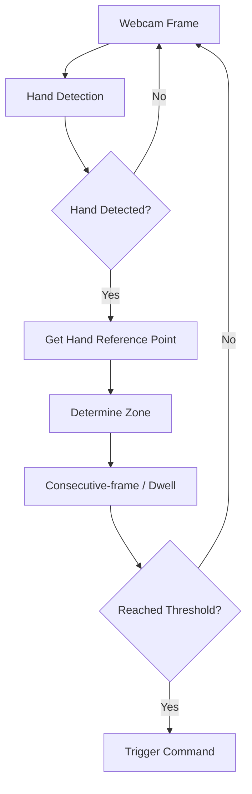

# HW5 — Vision-Based UI using Hand Detection

## 0. 作業題目

Vision-Based UI using Hand Detection

本作業繼承 HW4 的 Touchless Document Reader 題目與介面，但將主要輸入辨識方式由 Background Subtraction 改為 Hand Detection。

共用系統介面請參考：

`Touchless_Document_Reader_UI.md`

---

## 1. 作業目的

1. 使用電腦攝影機取得即時畫面。
2. 使用 Hand Detection 偵測使用者手部。
3. 使用固定 Hand Reference Point 判斷手目前位於哪個操作 Zone。
4. 使用 Dwell / Consecutive-frame confirmation 避免手經過區域時誤觸。
5. 分析 dwell setting 與環境光線變暗對操作穩定性的影響。

---

## 2. 系統介面

完全沿用 `Touchless_Document_Reader_UI.md`。

共 6 個 Zones：
- Z1：Previous Page
- Z2：Next Page
- Z3：Zoom In
- Z4：Zoom Out
- Z5：Menu
- Z6：Settings

HW5 不更改 UI layout，以便與 HW4 保持一致。

---

## 3. 辨識原理



建議使用 MediaPipe Hands 或等效 Hand Detection 方法。

正式實驗固定同一個 detector 與 detection confidence threshold。

---

## 4. Hand Reference Point

正式實驗固定使用：
```text
Wrist Landmark
```

理由：
- 穩定
- 容易取得
- 不需要額外 gesture classification
- 學長作業亦使用 wrist 作 ROI 判斷

Wrist coordinate `(cx, cy)` 用來判斷 Z1–Z6。

---

## 5. Dwell / Consecutive-frame Logic

手快速經過某區時不立即觸發。

```text
same zone detected
for K consecutive frames
→ trigger
```

觸發後加入 cooldown。

---

## 6. Experiment 1 — 6 Commands Basic Accuracy

### 目的
確認 Hand Detection 是否能正確控制 6 個 Commands。

### 條件
- Normal Lighting
- baseline dwell setting
- 每個 command 5 次

總計：
```text
6 × 5 = 30 trials
```

### 記錄
- trial_id
- target_zone
- target_command
- hand_detected
- detected_zone
- triggered_command
- correct
- trigger_time_ms
- false_trigger

### Metrics
- Overall Success Rate
- Per-command Success Rate
- Hand Detection Failure Count
- False Trigger Count
- Mean Trigger Time

---

## 7. Experiment 2 — Dwell / Consecutive Frames

### 目的
分析不同 dwell confirmation 長度對準確度與反應速度的影響。

### Representative Commands
- Previous
- Next
- Zoom In

### Conditions
建議三組：
- Short
- Medium
- Long

實作可先用：
```text
K = 3
K = 6
K = 10
```

正式值可根據 webcam FPS 與 Pilot 微調，但固定後不可在正式實驗中改變。

### Repetitions
```text
3 commands × 3 dwell settings × 3 repetitions
= 27 trials
```

### Metrics
- Success Rate
- False Trigger
- Mean Trigger Time
- Detection Failure Count

---

## 8. Experiment 3 — Lighting Interference Test

### 目的
分析光線變暗是否影響 Hand Detection-based interaction。

環境干擾統一只測：
- Normal Lighting
- Dim Lighting

### Representative Commands
- Previous
- Next
- Zoom In

### Repetitions
```text
3 commands × 2 lighting conditions × 3 repetitions
= 18 trials
```

### Metrics
- Success Rate
- Hand Detection Failure Count
- False Trigger
- Mean Trigger Time

---

## 9. HW5 實驗總量

```text
Experiment 1 = 30
Experiment 2 = 27
Experiment 3 = 18
Total = 75 trials
```

---

## 10. 與 HW4 的關係

HW5 沿用：
- 相同 6 Zones
- 相同 Commands
- 相同文件頁面
- 相同介面 layout

但辨識方法改為 Hand Detection。

HW5 的主要 command selection 不應依賴 HW4 的 foreground motion threshold。

---

## 11. Screenshots

至少保存：
1. 完整 Document Reader UI
2. Hand Landmarks
3. Wrist / Reference Point 顯示
4. Previous Zone 被選取
5. Next Zone 被選取
6. Bottom Toolbar 被選取
7. Normal Lighting
8. Dim Lighting
9. Detection Failure / False Trigger（若有）

---

## 12. 書面報告架構

### 1. 目的
說明 Vision-Based UI、Hand Detection、Touchless Document Reader、與 HW4 的延續關係與實驗目的。

### 2. 辨識原理、程式碼撰寫重點
至少包含：
- MediaPipe Hands 或所選 detector
- Detection confidence
- Wrist Reference Point
- Coordinate conversion
- 6 Zones
- Point-in-ROI 判斷
- Dwell / Consecutive Frames
- Cooldown
- 6 Commands Mapping

### 3. 介面與實驗設計
介面引用 `Touchless_Document_Reader_UI.md`。

實驗包含：
1. 6 Commands Basic Accuracy
2. Dwell / Consecutive Frames Test
3. Normal vs Dim Lighting

### 4. 實驗結果與討論
至少包含：
- Overall / Per-command Accuracy
- Detection Failure
- Short / Medium / Long Dwell
- False Trigger
- Trigger Time
- Normal vs Dim Lighting
- Error Cases
- Hand Detection 相較 Background Subtraction 的實務差異

HW5 報告可額外加入 HW4 / HW5 方法比較，但不需要另做正式比較實驗。

---

## 13. 最終 Checklist

- [ ] 使用共用 Document Reader UI
- [ ] 6 Zones
- [ ] Hand Detection
- [ ] 固定 Wrist 作 reference point
- [ ] Consecutive-frame / Dwell
- [ ] Cooldown
- [ ] 不以 Background Subtraction 作主要 command selection
- [ ] Experiment 1 完成
- [ ] Experiment 2 完成
- [ ] Experiment 3 完成
- [ ] Screenshots
- [ ] Report 至少包含四大章節
