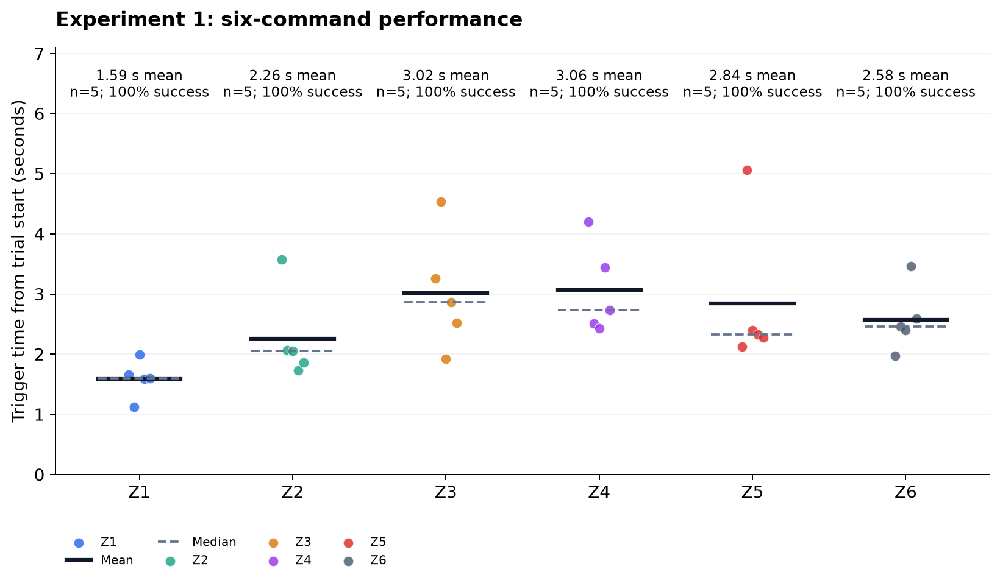
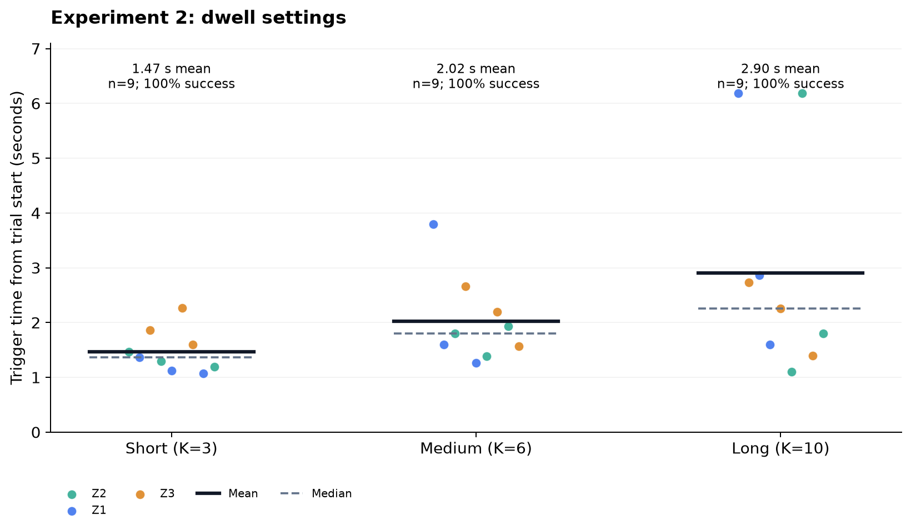
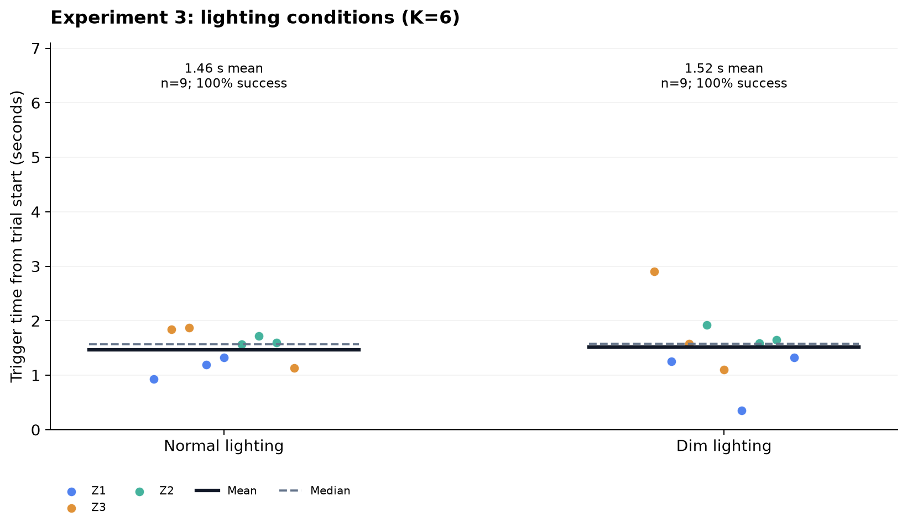

# HW5 實驗結果與分析

## 資料與檢查

2026 年 11 月 6 日收集的三份正式 CSV 共 75 次，實驗一 30 次、實驗二 27 次、實驗三 18 次。各指令、條件與重複次數完整，沒有重複 trial；20 次 Pilot 觸發獨立保存，不納入正式統計。原始 CSV 未改動。逐項驗證與來源 SHA256 見 [validation.json](validation.json)。

三份來源為：

- [experiment1_20261106-211554-402383.csv](../experiment1_20261106-211554-402383.csv)
- [experiment2_20261106-211944-097386.csv](../experiment2_20261106-211944-097386.csv)
- [experiment3_20261106-212231-247232.csv](../experiment3_20261106-212231-247232.csv)

三個 confidence 均為 0.5、cooldown 為 1 秒、timeout 為 8 秒，MediaPipe 版本 0.10.35，模型雜湊一致且與本機模型相符。實驗一、三的 K=6；實驗二為 3／6／10。各試驗記錄的平均處理 FPS 為 14.90–15.50。實驗三先執行正常光線，再執行昏暗光線。

## 整體結果

| 條件 | 次數 | 正確率 | 平均（ms） | 中位數（ms） | 標準差（ms） | 範圍（ms） |
|---|---:|---:|---:|---:|---:|---:|
| 實驗1 | 30 | 100.0% | 2557.8 | 2395.3 | 909.2 | 1126.0–5064.8 |
| 實驗2 | 27 | 100.0% | 2132.3 | 1597.5 | 1330.8 | 1068.1–6190.4 |
| 實驗3 | 18 | 100.0% | 1492.1 | 1571.2 | 522.5 | 358.0–2907.8 |

75/75 次正確，整體成功率 100%。三組的誤觸、逾時、全程未偵測次數均為 0。這是本次受控操作的指令成功率，不能解讀為每個影格都正確偵測到手，亦不代表所有使用者與環境都會達到 100%。各組任務與條件不同，合併平均延遲不適合用來比較辨識方法。

觸發時間從按下「開始計時」到第一個指令被辨識，包含使用者伸手、移動、區域對準與連續影格確認，不是單純的模型推論時間。下表與圖表保留所有試驗，沒有刪除較慢樣本；標準差採樣本標準差，圖中每點代表一次試驗，實線為平均、虛線為中位數。

## 實驗一：六個指令

| 條件 | 次數 | 正確率 | 平均（ms） | 中位數（ms） | 標準差（ms） | 範圍（ms） |
|---|---:|---:|---:|---:|---:|---:|
| 實驗一 Z1 | 5 | 100.0% | 1593.2 | 1597.3 | 309.7 | 1126.0–1995.1 |
| 實驗一 Z2 | 5 | 100.0% | 2256.6 | 2056.1 | 749.2 | 1733.0–3573.6 |
| 實驗一 Z3 | 5 | 100.0% | 3018.6 | 2861.1 | 978.7 | 1918.1–4531.6 |
| 實驗一 Z4 | 5 | 100.0% | 3062.7 | 2735.3 | 750.2 | 2431.7–4199.4 |
| 實驗一 Z5 | 5 | 100.0% | 2839.9 | 2330.7 | 1247.7 | 2128.1–5064.8 |
| 實驗一 Z6 | 5 | 100.0% | 2575.5 | 2460.7 | 546.8 | 1971.4–3461.4 |

六項指令各成功 5/5 次。Z1 Previous 平均 1.59 秒最快，Z4 Zoom Out 平均 3.06 秒最慢；Z3、Z4、Z5 約為 2.84–3.06 秒。底部工具列可能需要較多手腕定位時間，但資料沒有分開記錄移動與確認階段，因此不能直接歸因於區域尺寸或辨識演算法。

最慢的 E1-006（Z5）為 5064.8 ms，76 個影格中有 70 個無手偵測，且沒有有手轉無手的事件。這與較晚出現可偵測手部相容，無法單靠 CSV 判定是使用者等待、手未進入畫面，或手已在畫面但未被偵測。

## 實驗二：停留確認長度

| 條件 | 次數 | 正確率 | 平均（ms） | 中位數（ms） | 標準差（ms） | 範圍（ms） |
|---|---:|---:|---:|---:|---:|---:|
| 實驗二 Short | 9 | 100.0% | 1471.5 | 1368.1 | 387.6 | 1068.1–2265.1 |
| 實驗二 Medium | 9 | 100.0% | 2023.0 | 1800.2 | 791.2 | 1266.1–3799.4 |
| 實驗二 Long | 9 | 100.0% | 2902.4 | 2260.4 | 1951.4 | 1104.5–6190.4 |

Short、Medium、Long 均成功 9/9 次。平均觸發時間由 1471.5 ms 增至 2023.0 ms、2902.4 ms；Long 比 Short 多 1430.9 ms（約 97.2%）。中位數也依序增加：1368.1、1800.2、2260.4 ms。三組各包含相同的三個指令與重複次數，組成平衡。

約 15 FPS 時，K=3／6／10 的 K/FPS 時間尺度約為 0.20／0.40／0.67 秒；這只用來理解影格設定，不能當成實測停留時間。觀察到的總延遲差距較大，表示使用者進入操作區的時機與辨識過程也影響結果。

Long 有兩次約 6.19 秒的試驗，均保留於分析：E2-001 有 93 個影格，其中 83 個無手偵測；E2-020 有 93 個影格，其中 73 個無手偵測，並有 2 次有手轉無手事件。Long 的標準差因此達 1951.4 ms，平均值比中位數更受長尾影響。

本次資料支持「較短 K 的總操作時間較短」的描述，但三組皆無誤觸，沒有觀察到長 K 降低誤觸的效益。因此尚無法用本次結果證明 Long 更穩定，或認定 Short 在快速掃過區域時仍同樣可靠。正式設定保留 Medium K=6 是現有 baseline；若要選出最佳設定，需要補測快速經過區域與邊界干擾等情境。

## 實驗三：正常與昏暗光線

| 條件 | 次數 | 正確率 | 平均（ms） | 中位數（ms） | 標準差（ms） | 範圍（ms） |
|---|---:|---:|---:|---:|---:|---:|
| 實驗三 Normal Lighting | 9 | 100.0% | 1463.7 | 1568.8 | 332.2 | 930.8–1869.7 |
| 實驗三 Dim Lighting | 9 | 100.0% | 1520.5 | 1573.7 | 684.1 | 358.0–2907.8 |

正常與昏暗光線皆成功 9/9 次。昏暗平均多 56.8 ms（約 3.9%），中位數僅多 4.9 ms；昏暗條件的標準差較大（684.1 vs 332.2 ms）。樣本範圍重疊，本次沒有觀察到指令成功率下降，也沒有足夠證據認定兩種光線等效或存在穩定的速度差異。

兩條件各有三個相同指令、各重複 3 次，但本次實際順序為正常後昏暗，仍可能受到熟練或疲勞影響。CSV 未記錄照度、相機曝光與操作距離，不能將結果外推到所有低光環境。

## 偵測事件與失敗指標

三組累計 2428 個處理影格，其中 1814 個無手偵測，另有 11 次有手轉無手事件與 1 個雙手影格。這些事件沒有讓正式試驗誤觸或逾時。由於計時從手移出畫面時開始，`no_hand_frames` 包含伸手前的空窗，不能將 1814/2428 當作偵測失敗率。

`detection_failure` 的定義是「試驗逾時且全程未偵測到手」，本次為 0；11 次 `tracking_loss_count` 也可能包含主動移手，不能全部歸類為演算法故障。缺少逐影格真實標記與事件時間序列，無法算出真正的影格偵測準確率、失去追蹤時長或每次重新累積的停留時間。

## 限制與可寫入報告的結論

這批資料顯示，在本次環境與操作流程中，手腕定位搭配 K 影格確認可以完成六項指令，75 次均成功。K 越長的組別總觸發時間越長；在本次正常與昏暗兩個條件下，均未出現指令失敗。由於所有條件的成功率都達上限，準確率無法進一步區分設定優劣。

CSV 未提供參與者識別碼與人數，且每個細分條件只有 3 或 5 次；不能把 75 次當成 75 位獨立使用者。本分析採描述統計，不宣稱統計顯著性，也不對平均值差距做因果推論。若需進一步研究，可增加不同使用者、量測光照，並加入快速掠過、邊界停留、遮擋與背景移動的試驗。

HW5 以手腕位置選取區域，HW4 以前景變化比例選取區域，兩者的輸入依據不同。這批資料沒有同步的 HW4 對照條件，因此可比較辨識原理，不能據此宣稱 HW5 的實驗準確率優於 HW4。

## 重現

在作業五資料夾執行 `python analyze_experiments.py`。程式會驗證三份指定來源，重建本分析、PNG／SVG 圖表、[摘要指標 CSV](summary_metrics.csv) 與 [基本統計表](basic_summary.md)。需要 `requirements.txt` 與 matplotlib（已列於 requirements-lock.txt）。
